<div align="center">
    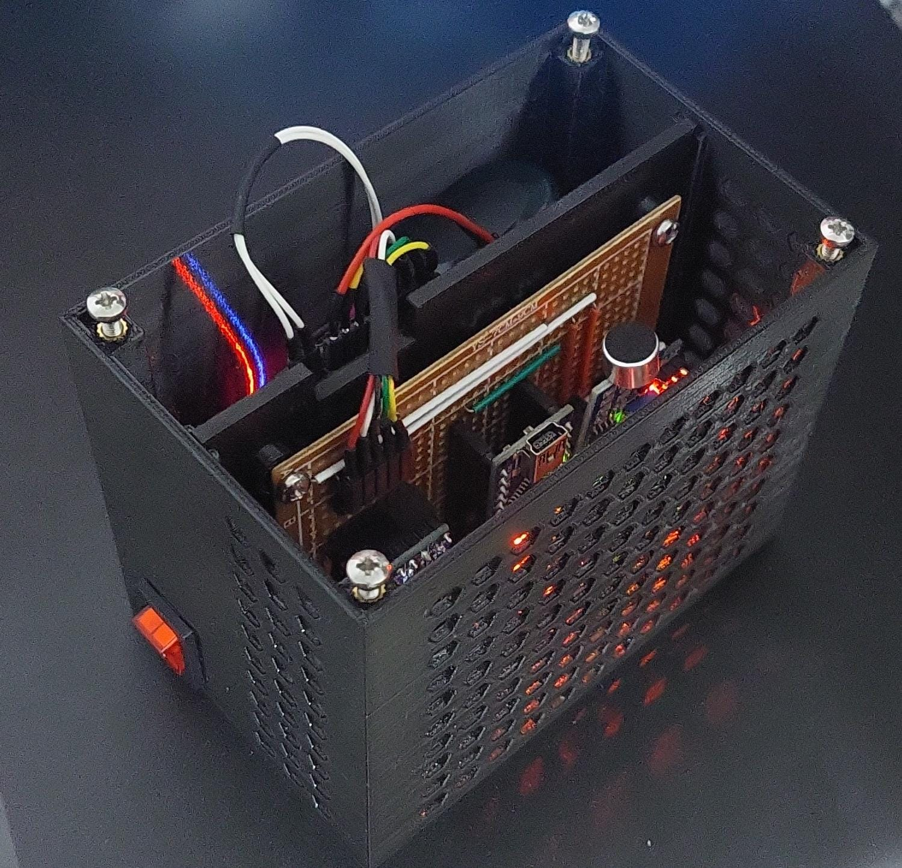
    <h1>Configurable Indoor Air Quality Monitoring System ( 2023 )</h1>
</div>


<!-- ______________________________________________________________________________________________________________________________________________________ INTRODUCTION -->
# :rocket: 1. Introduction

This project developed the infrastructure for a configurable indoor air quality monitoring system using modular, wirelessly reconfigurable devices that can be deployed anywhere indoors and adapted to changing requirements without reprogramming.

Each device consists of a modular sensor board for environmental monitoring and a transmitter board that collects sensor data and sends it to a server via a serial interface.
Its compact, battery-powered design enables flexible placement, while a custom web dashboard provides real-time data visualization.

**Project demo**: [ demo_link ]( https://drive.google.com/file/d/12pxGG4WmBNYgOO-bVUk5fnq6-0USTvlY/view )


**FIGURE: Project architecture**

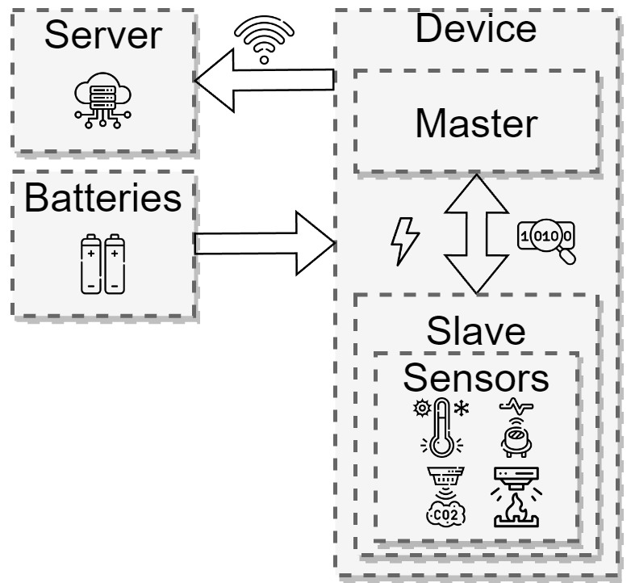


<!-- ______________________________________________________________________________________________________________________________________________________ TABLE OF CONTENT -->
# :ledger:Table of content

- [:rocket: 1. Introduction](#rocket-1-introduction)
- [:ledger:Table of content](#ledgertable-of-content)
- [:gear: 2. Hardware description](#gear-2-hardware-description)
- [:wrench: 3. Hardware implementation](#wrench-3-hardware-implementation)
  - [3.1 Schematic and layouts](#31-schematic-and-layouts)
    - [3.1.1 ESP32 Master Board](#311-esp32-master-board)
    - [3.1.2 ATMEGA328P slave boards](#312-atmega328p-slave-boards)
  - [3.2 3D Enclosure](#32-3d-enclosure)
  - [3.3 Final Product](#33-final-product)
- [:sparkles: 4. Software implementation](#sparkles-4-software-implementation)
  - [4.1 MCU Firmware](#41-mcu-firmware)
    - [4.1.1 ESP32 Firmware](#411-esp32-firmware)
    - [4.1.2 ATmega328P Firmware](#412-atmega328p-firmware)
  - [4.2 Node-RED](#42-node-red)
- [:checkered\_flag: 5. Conclusion](#checkered_flag-5-conclusion)
- [:books: 5. Resources](#books-5-resources)


<!-- ______________________________________________________________________________________________________________________________________________________ HARDWARE DESCRIPTION -->
# :gear: 2. Hardware description

The system consists of two board types:

* **Slave board** – acquires environmental data from sensors
* **Master board** – acquires data from sensor boards and transmits it to the server

Each board is built around its own microcontroller ( MCU ).
To validate the design, three boards were developed: one master board and two slave boards, whose main components are listed below:

1. Master board
    - 1x [ ESP32 board ]( https://www.emag.ro/placa-dezvoltare-esp-wroom-32-esp-32s-ai011-s332/pd/D3NF9VBBM/?ref=history-shopping_346242005_38837_1 )
2. Slave board 1
    - 1x [ Arduino Nano board ]( https://www.optimusdigital.ro/ro/compatibile-cu-arduino-nano/1686-placa-de-dezvoltare-compatibila-cu-arduino-nano-atmega328p-i-ch340.html ) ( with ATMEGA328P MCU )
    - 1x [ ADT7410 module ]( https://www.optimusdigital.ro/ro/senzori-senzori-de-temperatura/7542-modul-senzor-de-temperatura-adafruit-cu-acuratee-ridicata-adt7410-i2c.html ) ( high accuracy digital temperature sensor )
    - 1x [ MQ2 module ]( https://www.optimusdigital.ro/ro/senzori-de-gaze/107-modul-senzor-gas-mq-2.html?search_query=mq2&results=1 ) ( analog gas sensor )
    - 1x [ level shifter module ]( https://www.optimusdigital.ro/ro/interfata-convertoare-de-niveluri/182-translator-de-nivel-bidirectional-cu-2-canale.html )
3. Slave board 2
    - 1x [ Arduino Nano board ]( https://www.optimusdigital.ro/ro/compatibile-cu-arduino-nano/1686-placa-de-dezvoltare-compatibila-cu-arduino-nano-atmega328p-i-ch340.html )
    - 1x [ Microphone module ]( https://www.techonicsltd.com/product/microphone-sound-sensor-module-compatible-with-official-arduino-boards/ ) ( sound sensor )
    - 1x [ DS18B20 module ]( https://www.optimusdigital.ro/ro/senzori-senzori-de-temperatura/172-modul-senzor-de-temperatura-ds18b20.html ) ( digital temperature sensor )
    - 1x [ level shifter module ]( https://www.optimusdigital.ro/ro/interfata-convertoare-de-niveluri/182-translator-de-nivel-bidirectional-cu-2-canale.html )


<!-- ______________________________________________________________________________________________________________________________________________________ HARDWARE DESCRIPTION -->
# :wrench: 3. Hardware implementation

## 3.1 Schematic and layouts

The schematics for the master and slave boards, along with the master board PCB layout, were designed in **Altium Designer**, a professional electronic design automation ( EDA ) tool for schematic capture and PCB development.


### 3.1.1 ESP32 Master Board

The master board is powered by a battery pack consisting of two 18650 Li-ion cells connected in series, providing a nominal input voltage of approximately 7.4 V.
A reverse-polarity protection diode and an external rocker switch ensure safe and convenient operation.

To support a wide range of sensors, the board provides both **3.3 V** and **5 V** power rails.
Because the system is battery-powered, linear regulators were avoided due to their poor efficiency at converting 7.4 V to lower voltages.
Instead, two **MCP16311** synchronous buck regulators ( 1 A output ) generate the required voltages with high efficiency across a wide load range.
Each regulator integrates both switching MOSFETs and operates at a switching frequency of **500 kHz**.

An **ESP32 development board** is mounted via dual female headers.
The battery voltage is monitored through a resistor divider connected to an ADC input, while connector **J1** supplies power to and provides serial communication with the slave board.

The complete master board schematic is shown below.


**FIGURE: Master board schematic**

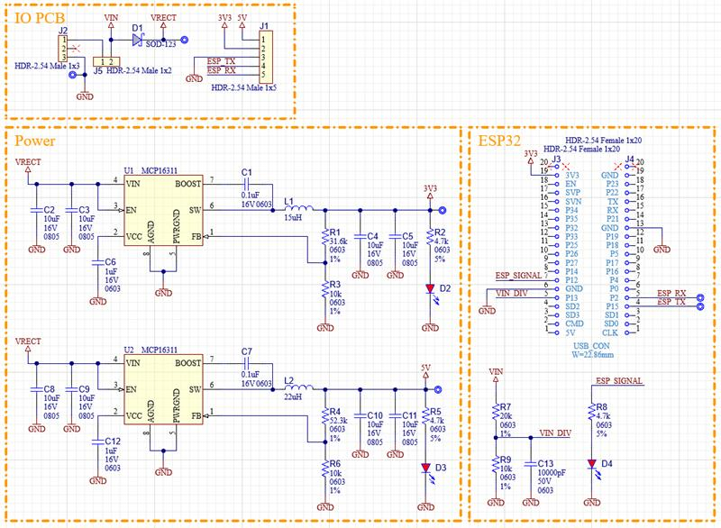


The master board PCB layout was optimized for a compact footprint and single-sided manufacturing, minimizing the number of wire bridges required.
It is mounted using three M3×8 screws, and includes three optional LEDs for debugging and status indication.


**FIGURE: Master board layout ( top view )**

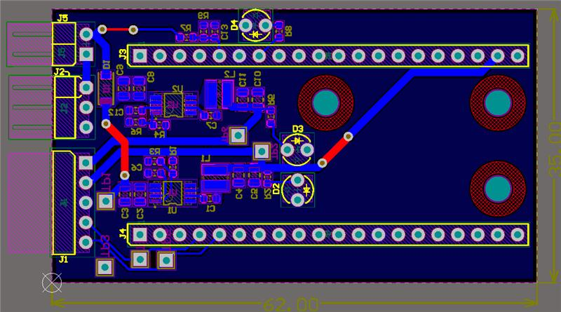

**FIGURE: Master board 3D model ( top view )**

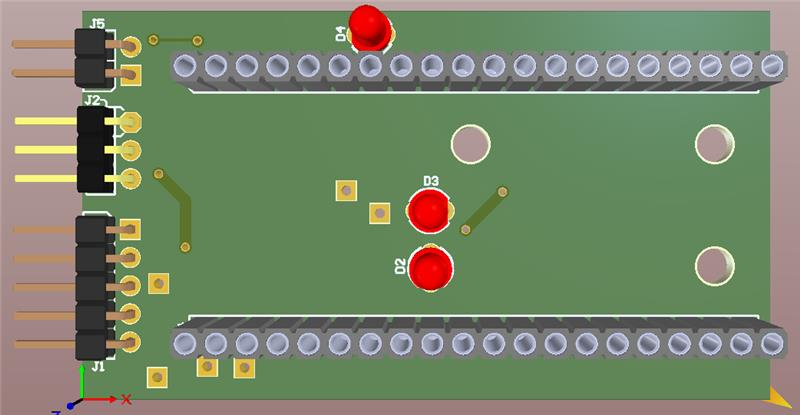

**FIGURE: Master board 3D model ( bottom view )**

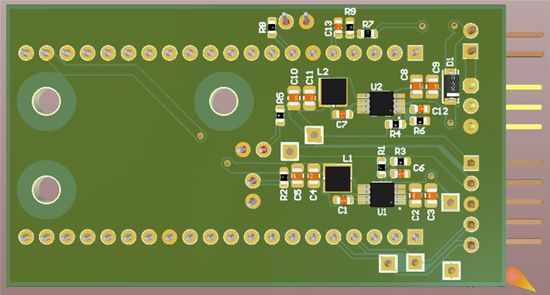


**FIGURE: Master board after soldering ( top view )**

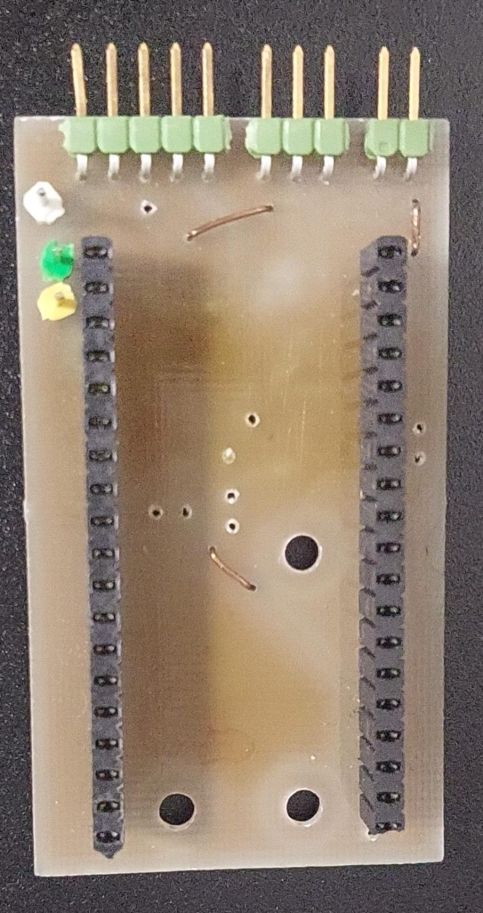

**FIGURE: Master board after soldering ( bottom view )**

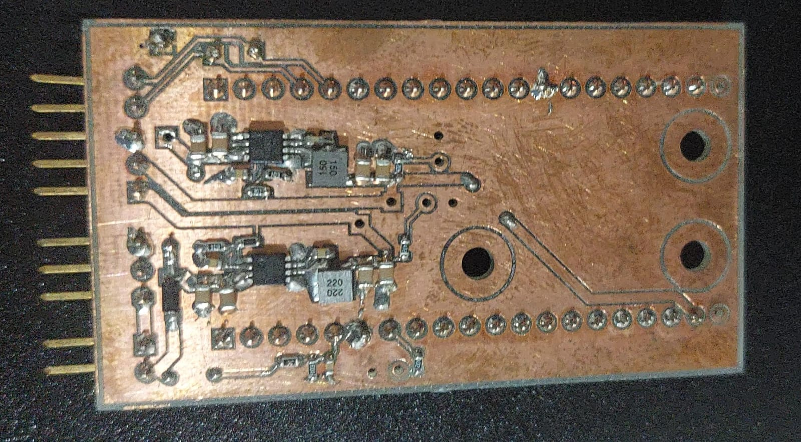


### 3.1.2 ATMEGA328P slave boards

The slave boards are based on the **Arduino Nano ( ATmega328P )**, which operates at **5 V** logic levels.
Since the master board's **ESP32** uses **3.3 V** logic, a bidirectional level shifter is used to ensure safe serial communication between the two boards.

The **ADT7410** temperature sensor communicates over the **I²C** interface and supports two interrupt outputs.
Its address pins ( **A0** and **A1** ) are tied to **GND**, configuring the device to the default I²C address of **0x48**.

The **MQ-2** gas sensor provides an analog output proportional to the concentration of combustible gases, including propane, hydrogen, and methane.


**FIGURE: Slave 1 board schematic**

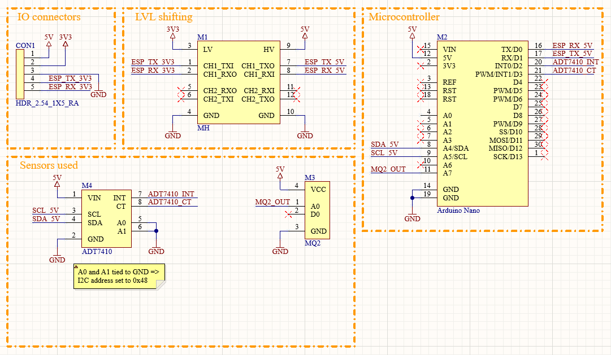


The **sound sensor** provides an analog output proportional to the detected sound level, while the **DS18B20** digital temperature sensor communicates using the **1-Wire** protocol.


**FIGURE: Slave 2 board schematic**

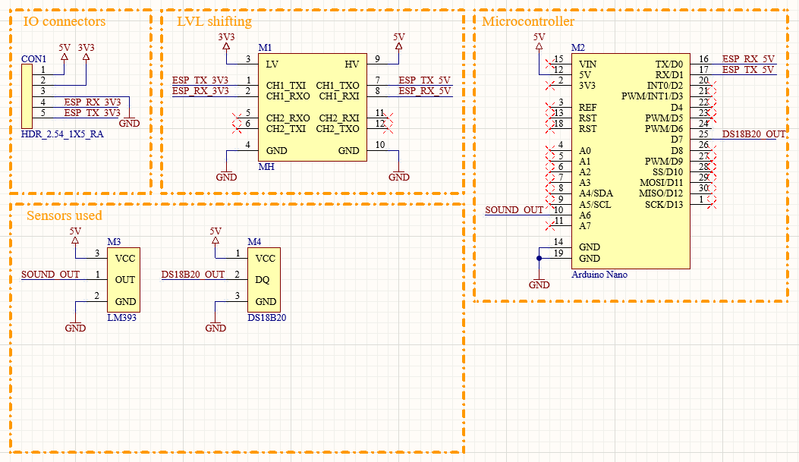


The slave boards were assembled on two perforated prototyping PCBs, with all electrical connections hand-wired.


**FIGURE: Slave 1 board after soldering ( top view )**

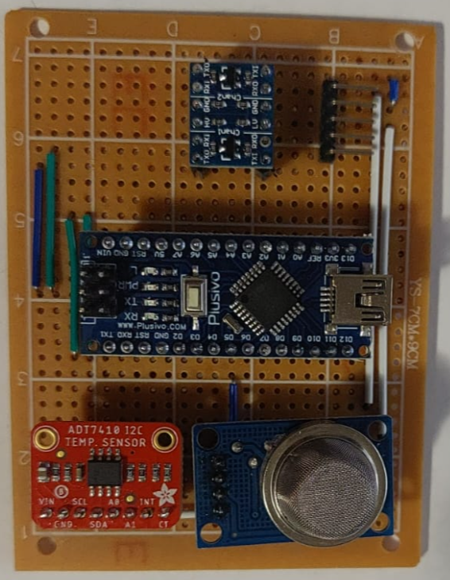

**FIGURE: Slave 1 board after soldering ( bottom view )**

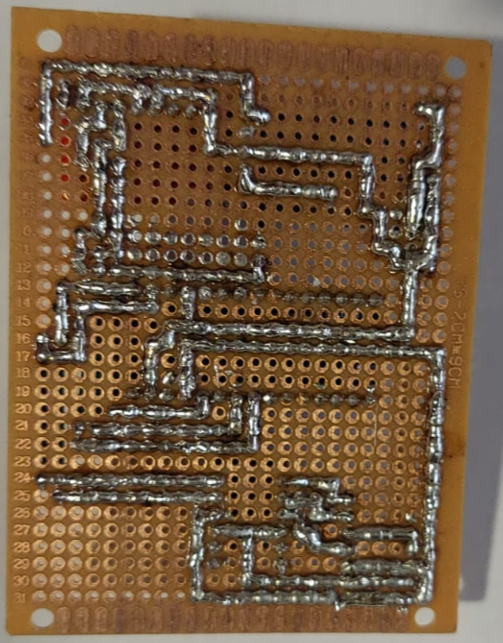

**FIGURE: Slave 2 board after soldering ( top view )**

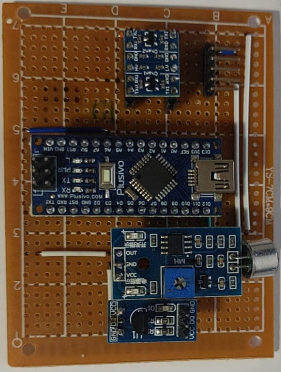

**FIGURE: Slave 2 board after soldering ( bottom view )**

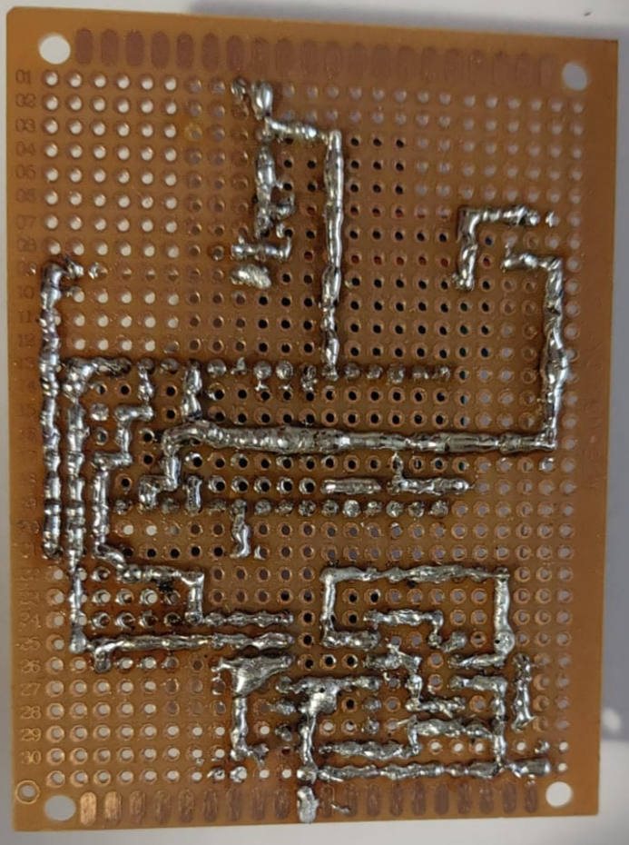


## 3.2 3D Enclosure

The enclosure was designed in **Fusion 360** and prepared for 3D printing using **PrusaSlicer**.
It consists of three parts and houses the master board, slave board, battery pack, and rocker switch.

The **middle section** serves as the main structural component, with the master and slave boards mounted using seven M3 screws and interconnected by a cable.
A 3 mm clearance is maintained on both sides of the boards; to avoid the need for printing supports, the spacing on one side is achieved using separate spacer components.


**FIGURE: Middle part ( front view )**

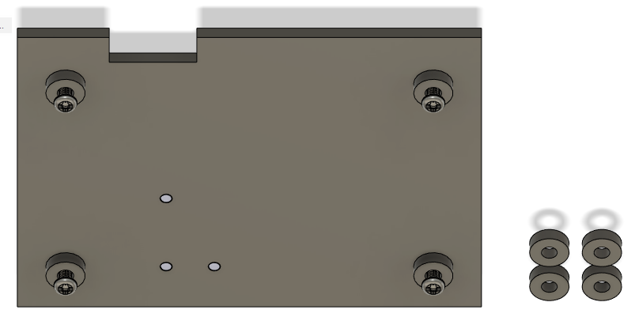

**FIGURE: Middle part ( back view )**

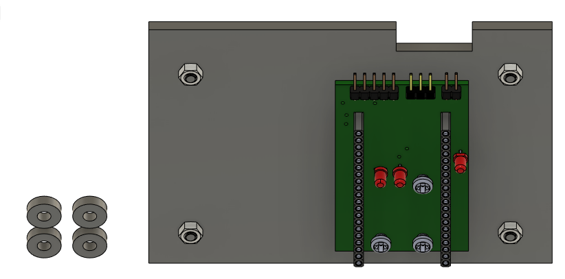


The **bottom section** houses the battery pack and rocker switch.
The middle section slides into place using a central guide rail, while four threaded heat-set inserts provide secure mounting for the enclosure screws.


**FIGURE: Bottom part ( left view )**

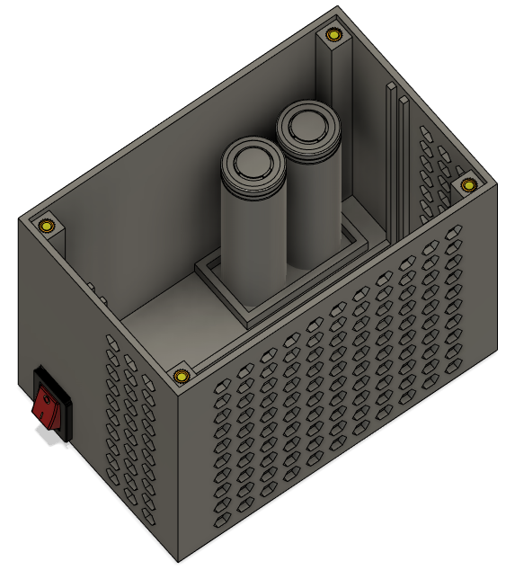

**FIGURE: Bottom part ( right view )**

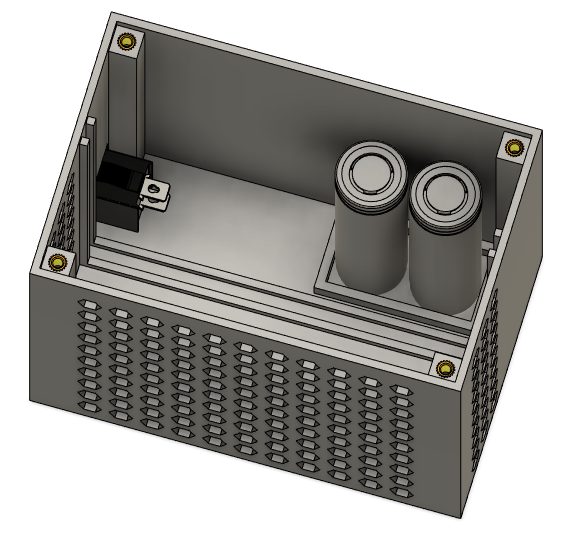


The **top section** closes the enclosure and is secured with four M3×10 screws.
An integrated retaining feature keeps the battery pack firmly in place.


**FIGURE: Top part ( top view )**

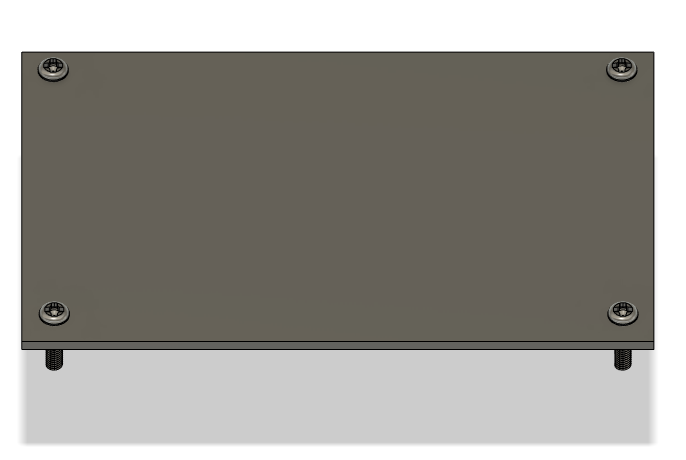

**FIGURE: Top part ( bottom view )**

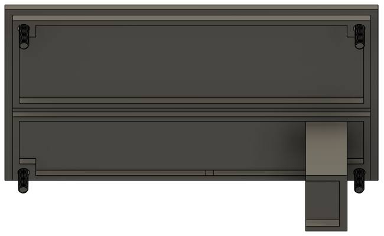


## 3.3 Final Product

The completed device is shown below in the left and top views.


**FIGURE: Final product ( top view )**

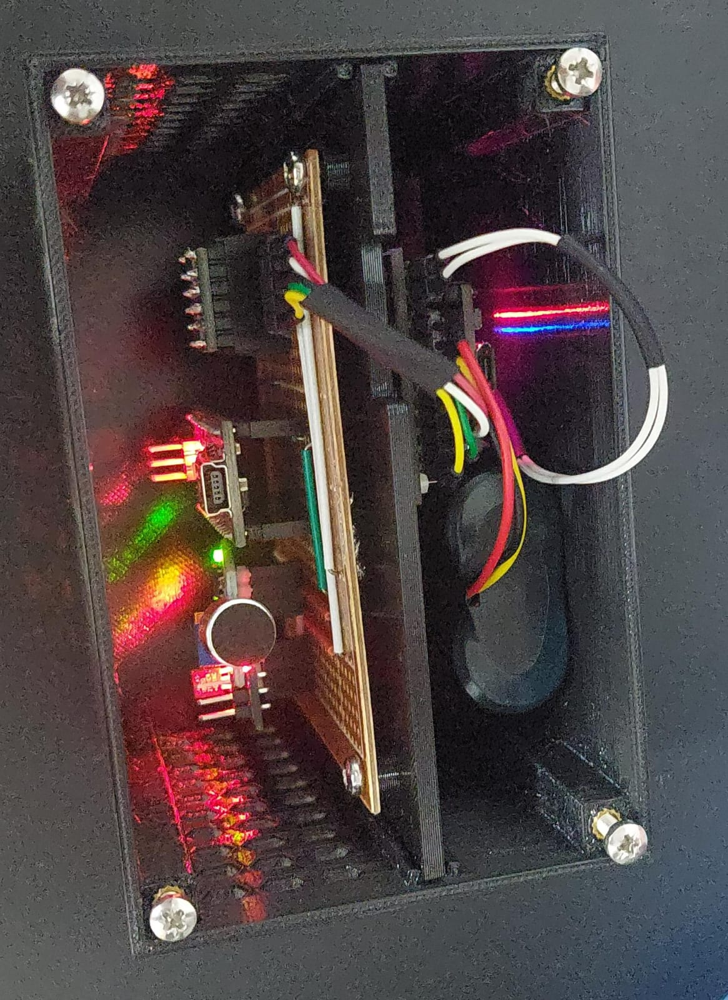

**FIGURE: Final product ( left view )**


<!-- ______________________________________________________________________________________________________________________________________________________ SOFTWARE DESCRIPTION -->
# :sparkles: 4. Software implementation

## 4.1 MCU Firmware

Communication between the master and slave boards is implemented using the **UART** protocol at **115200 baud, 8 data bits, no parity, and 1 stop bit ( 8N1 )**.
All communication is initiated by the master.
During startup, the master requests the list of parameters supported by the slave boards, then periodically reads and processes the sensor data.
If the slave fails to respond within **5 seconds**, the master enters a timeout state and halts communication.

The communication state machine is shown in the figure below.


**FIGURE: Serial comm state machine**

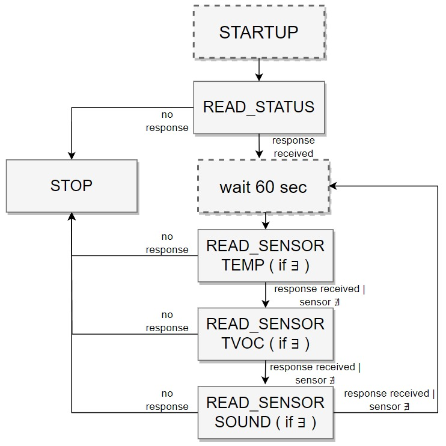


Two UART commands are implemented: **`UART_CMD_READ_SENSORS_STATUS`**, which retrieves the sensor configuration during startup, and **`UART_CMD_READ_SENSORS_DATA`**, which requests the latest sensor measurements.
Both commands are 2 bytes long, while their corresponding responses are 4 bytes and 8 bytes, respectively.


### 4.1.1 ESP32 Firmware

The ESP32 firmware requires the **Wi-Fi SSID**, **password**, and **MQTT broker IP address** to establish a network connection and communicate with the MQTT broker.

``` c
////////////////////////////////////////////////////////////////////////////////////////////////////////////////////////////// WIFI SETUP
#include <WiFi.h>
#include <PubSubClient.h>
#include <Wire.h>

const char* ssid        = "TO_BE_REPLACED"; // WiFi SSID
const char* password    = "TO_BE_REPLACED"; // WiFi password
const char* mqtt_server = "TO_BE_REPLACED"; // MQTT server

WiFiClient   espClient;
PubSubClient client( espClient );
```

The functions used for WiFi:

``` c
////////////////////////////////////////////////////////////////////////////////////////////////////////////////////////////// WIFI FUNCTIONS
// This functions connects your ESP8266 to your router
void setup_wifi() {
    delay( 10 );
    Serial.println();
    Serial.print("Connecting to ");
    Serial.println( ssid );
    Serial.print("Password used: ");
    Serial.println( password );
    WiFi.mode( WIFI_STA );
    WiFi.begin( ssid, password );
    while( WiFi.status() != WL_CONNECTED )
    {
        delay( 500 );
        Serial.print( "." );
    }
    Serial.println("");
    Serial.print( "WiFi connected - ESP IP address: " );
    Serial.println( WiFi.localIP() );
}

// This function is executed when some device publishes a message to a topic that your ESP8266 is subscribed to
// Change the function below to add logic to your program, so when a device publishes a message to a topic that
// your ESP8266 is subscribed you can actually do something
void callback( String topic, byte* message, unsigned int length )
{
    Serial.print( "Message arrived on topic: " );
    Serial.println( topic );
}

// This functions reconnects your ESP8266 to your MQTT broker
// Change the function below if you want to subscribe to more topics with your ESP8266
void reconnect()
{
    while( !client.connected() )
    {
        Serial.print( "Attempting MQTT connection..." );
        if( client.connect( "ESP8266Client" ) )
        {
            Serial.println( "connected" );
        }
        else
        {
            Serial.print( "failed, rc=" );
            Serial.print( client.state() );
            Serial.println( " try again in 5 seconds" );
            delay( 5000 );
        }
    }
}
```

The serial communication can be configured by modifying the macros below:

``` c
////////////////////////////////////////////////////////////////////////////////////////////////////////////////////////////// SERIAL COMM SETUP
// general macros
#define TRUE                                        true
#define FALSE                                       false

#define SERIAL_1_BAUDRATE                           115200
#define SERIAL_2_BAUDRATE                           115200

#define ESP_MASTER_RX_PIN                           15
#define ESP_MASTER_TX_PIN                           2

#define UART_CHECK_COUNTER_MAX                      10
#define UART_TIMEOUT_COUNTER_MAX                    50

#define UART_END_BYTE				                0x55

// command list
#define UART_CMD_READ_SENSORS_STATUS		        0x10
#define UART_CMD_READ_SENSORS_DATA		            0x20

// flags pos
#define SENSOR_TEMP_SUPPORTED                       0x01
#define SENSOR_TVOC_SUPPORTED                       0x02
#define SENSOR_SOUND_SUPPORTED                      0x04

#define UART_REQUEST_CMD_MAX_LENGTH	                2
#define UART_RESPONSE_READ_DATA_MAX_LENGTH	        8
#define UART_RESPONSE_INIT_CMD_MAX_LENGTH	        4

#define UART_READ_BUFFER_LENGTH		                10
#define UART_WRITE_BUFFER_LENGTH		            5

// sensor flag position
#define SENSOR_TEMP_SUPPORTED                       0x01
#define SENSOR_TVOC_SUPPORTED                       0x02
#define SENSOR_SOUND_SUPPORTED                      0x04

// UART flags structure
typedef union
{
    struct{
        uint8_t is_busy                 :1,
                sensor_temp_supported   :1,
                sensor_tvoc_supported   :1,
                sensor_sound_supported  :1,
                                        :4;
    };

    uint8_t word8;
}UART_COM_FLAGS;

// UART main structure
typedef struct
{
	uint8_t write_buffer[UART_WRITE_BUFFER_LENGTH];
	uint8_t read_buffer[UART_READ_BUFFER_LENGTH];
	uint8_t buffer_counter;

    uint8_t check_counter;
    uint8_t timeout_counter;

    UART_COM_FLAGS flags;
}UART_COM_STRUCT;

UART_COM_STRUCT UART_com;
```

The serial communication is initialized by sending the **`UART_CMD_READ_SENSORS_STATUS`** command to retrieve the slave board's capabilities.
If no valid response is received, the master board enters a timeout state and halts operation.

``` c
////////////////////////////////////////////////////////////////////////////////////////////////////////////////////////////// SETUP FUNCTION
void init_com_protocol_UART()
{
    UART_com.flags.word8     = 0x00;
    UART_com.flags.is_busy   = TRUE;
    UART_com.timeout_counter = UART_TIMEOUT_COUNTER_MAX;
    UART_com.check_counter   = UART_CHECK_COUNTER_MAX;
    UART_com.buffer_counter  = 0;
    UART_com.write_buffer[0] = UART_CMD_READ_SENSORS_STATUS;
    UART_com.write_buffer[1] = UART_END_BYTE;
    Serial2.write( UART_com.write_buffer, 2 );
}
```

The WiFi and the serial communications are initialized in the setup functions:

``` c
////////////////////////////////////////////////////////////////////////////////////////////////////////////////////////////// SETUP FUNCTION
void setup() {
    // setup the serial comms
    Serial.begin(  SERIAL_1_BAUDRATE );
    Serial2.begin( SERIAL_2_BAUDRATE, SERIAL_8N1, ESP_MASTER_RX_PIN, ESP_MASTER_TX_PIN );
    delay( 4000 );

    // prepare wifi config
    setup_wifi();
    client.setServer( mqtt_server, 1883 );
    client.setCallback( callback );

    // init the serial config
    init_com_protocol_UART();

    Serial.println( "data sent" );
}
```

The master periodically sends the **`UART_CMD_READ_SENSORS_DATA`** command to acquire sensor measurements.
Upon receiving a valid response, it publishes the data to the MQTT broker according to the slave board's configuration.

``` c
////////////////////////////////////////////////////////////////////////////////////////////////////////////////////////////// LOOP FUNCTION
void loop()
{
    uint8_t data_byte_read;
    int8_t  flags_processed;

    // reconnect to MQTT
    if( !client.connected() )
    {
        reconnect();
    }
    if( !client.loop() )
    {
        client.connect( "ESP8266Client" );
    }

    // check for timeouts
    if( UART_com.flags.is_busy == TRUE )
    {
        UART_com.timeout_counter--;

        if( UART_com.timeout_counter == 0 )
        {
            UART_com.flags.word8 = 0x00;
            Serial.println( "Communication has been reset and blocked!" );
            while( 1 );
        }
    }
    else
    {
        UART_com.check_counter--;

        // read the sensors again
        if( UART_com.check_counter == 0 )
        {
            UART_com.flags.is_busy   = TRUE;
            UART_com.check_counter   = UART_CHECK_COUNTER_MAX;
            UART_com.timeout_counter = UART_TIMEOUT_COUNTER_MAX;

            UART_com.write_buffer[0] = UART_CMD_READ_SENSORS_DATA;
            UART_com.write_buffer[1] = UART_END_BYTE;
            Serial2.write( UART_com.write_buffer, 2 );
        }

    }

    // read every byte available from the receiver's buffer
    while( Serial2.available() )
    {
        data_byte_read = Serial2.read();

        if( UART_com.flags.is_busy == TRUE )
        {
            UART_com.timeout_counter = UART_TIMEOUT_COUNTER_MAX;
            UART_com.check_counter   = UART_CHECK_COUNTER_MAX;
            UART_com.read_buffer[UART_com.buffer_counter] = data_byte_read;
            UART_com.buffer_counter++;

            if( ( ( UART_com.buffer_counter == UART_RESPONSE_INIT_CMD_MAX_LENGTH  ) && ( UART_com.write_buffer[0] == UART_CMD_READ_SENSORS_STATUS ) ) ||
                ( ( UART_com.buffer_counter == UART_RESPONSE_READ_DATA_MAX_LENGTH ) && ( UART_com.write_buffer[0] == UART_CMD_READ_SENSORS_DATA   ) ) )
            {
                UART_com.flags.is_busy = FALSE;
                UART_com.buffer_counter = 0;

                switch( UART_com.read_buffer[0] )
                {
                    case UART_CMD_READ_SENSORS_STATUS:
                        Serial.println( "Config read ..." );

                        flags_processed = ( int8_t )( ( ( ( uint16_t )UART_com.read_buffer[2] ) << 8 ) | UART_com.read_buffer[1] );

                        UART_com.flags.sensor_temp_supported  = ( ( flags_processed & SENSOR_TEMP_SUPPORTED  ) != 0x00 ) ? TRUE : FALSE;
                        UART_com.flags.sensor_tvoc_supported  = ( ( flags_processed & SENSOR_TVOC_SUPPORTED  ) != 0x00 ) ? TRUE : FALSE;
                        UART_com.flags.sensor_sound_supported = ( ( flags_processed & SENSOR_SOUND_SUPPORTED ) != 0x00 ) ? TRUE : FALSE;
                        break;

                    case UART_CMD_READ_SENSORS_DATA:
                        Serial.println( "Data read ..." );

                        if( UART_com.flags.sensor_temp_supported  == TRUE ) { client.publish( "ESP32/temp",  String( ( float   )( ( ( uint16_t )UART_com.read_buffer[2] << 8 ) | UART_com.read_buffer[1] ) / 10 ).c_str() ); }
                        if( UART_com.flags.sensor_tvoc_supported  == TRUE ) { client.publish( "ESP32/tvoc",  String( ( int16_t )( ( ( uint16_t )UART_com.read_buffer[4] << 8 ) | UART_com.read_buffer[3] )      ).c_str() ); }
                        if( UART_com.flags.sensor_sound_supported == TRUE ) { client.publish( "ESP32/sound", String( ( int16_t )( ( ( uint16_t )UART_com.read_buffer[6] << 8 ) | UART_com.read_buffer[5] )      ).c_str() ); }

                        break;
                }
            }
        }
    }

    delay( 100 );
}
```

### 4.1.2 ATmega328P Firmware

The same firmware is used for both slave boards. The target board is selected at compile time by defining either **`USE_SLAVE_1`** or **`USE_SLAVE_2`**.
Exactly one of these macros must be defined; defining both or neither results in a compilation error.


``` c
////////////////////////////////////////////////////////////////////////////////////////////////////////////////////////////// SETUP SLAVE TO BUILD
#define USE_SLAVE_1
#undef  USE_SLAVE_1
#define USE_SLAVE_2
// #undef  USE_SLAVE_2


// checking the config
#if defined( USE_SLAVE_1 ) && defined( USE_SLAVE_2 )
    #error Multiple slaves defined at the same time!
#endif
#if !defined( USE_SLAVE_1 ) && !defined( USE_SLAVE_2 )
    #error No slaves defined!
#endif
```

Depending on which board is defined, a specific set of sensors will be used:

``` c
////////////////////////////////////////////////////////////////////////////////////////////////////////////////////////////// SLAVE 1 CONFIG
#ifdef USE_SLAVE_1
    #define USE_SENSOR_TEMP_ADT7410
    #define USE_SENSOR_TVOC_MQ2
#endif

////////////////////////////////////////////////////////////////////////////////////////////////////////////////////////////// SLAVE 2 CONFIG
#ifdef USE_SLAVE_2
    #define USE_SENSOR_SOUND_LM393
    #define USE_SENSOR_TEMP_DS18B20
#endif
```

The required sensor libraries and configuration settings are conditionally included based on the selected slave board.
The following functions are responsible for acquiring data from the corresponding sensors.

``` c
////////////////////////////////////////////////////////////////////////////////////////////////////////////////////////////// SENSOR FUNCTIONS
#ifdef USE_SENSOR_TVOC_MQ2
    #define SENSOR_TVOC_MQ2_PIN                     A7

    int16_t measure_sensor_tvoc_MQ2()
    {
        return ( int16_t )( analogRead( SENSOR_TVOC_MQ2_PIN ) );
    }
#endif

#ifdef USE_SENSOR_TEMP_DS18B20
    #include <OneWire.h>
    #include <DallasTemperature.h>

    #define SENSOR_TEMP_DS18B20_PIN                 7

    OneWire oneWire( SENSOR_TEMP_DS18B20_PIN );
    DallasTemperature sensor_DS18B20( &oneWire );

    int16_t measure_sensor_temp_DS18B20()
    {
        sensor_DS18B20.requestTemperatures();
        return ( int16_t )( sensor_DS18B20.getTempCByIndex( 0 ) * 10 );
    }
#endif

#ifdef USE_SENSOR_SOUND_LM393
    #define SENSOR_SOUND_LM393_PIN                  A6

    int16_t measure_sensor_SOUND_LM393()
    {
        return ( int16_t )( analogRead( SENSOR_SOUND_LM393_PIN ) );
    }
#endif

#ifdef USE_SENSOR_TEMP_ADT7410
    #include <Wire.h>
    #include <Adafruit_Sensor.h>
    #include "Adafruit_ADT7410.h"

    Adafruit_ADT7410 temp_sensor_ADT7410 = Adafruit_ADT7410();

    float measure_sensor_temp_ADT7410()
    {
        return ( int16_t )( temp_sensor_ADT7410.readTempC() * 10 );
    }
#endif
```

The function below is used to initialize all sensors that are being used.

``` c
////////////////////////////////////////////////////////////////////////////////////////////////////////////////////////////// INIT ALL SENSOR CONFIG
void init_all_sensor_config()
{
#ifdef USE_SENSOR_TVOC_MQ2
    pinMode( SENSOR_TVOC_MQ2_PIN, INPUT );
#endif
#ifdef USE_SENSOR_TEMP_DS18B20
    pinMode( SENSOR_TEMP_DS18B20_PIN, INPUT );
#endif
#ifdef USE_SENSOR_SOUND_LM393
    pinMode( SENSOR_SOUND_LM393_PIN, INPUT );
#endif
#ifdef USE_SENSOR_TEMP_ADT7410
    if( !temp_sensor_ADT7410.begin() )
    {
        Serial.println( "Couldn't find ADT7410!" );
        // while( 1 );
    }
#endif
}
```

The serial communication is implemented using the following macros:

``` c
////////////////////////////////////////////////////////////////////////////////////////////////////////////////////////////// SERIAL MACROS AND VARIABLES
// general macros used
#define UART_REQUEST_CMD_MAX_LENGTH                 2
#define UART_RESPONSE_CMD_MAX_LENGTH                4
#define UART_CMD_BYTE_POS                           0
#define UART_END_BYTE_POS                           1
#define UART_END_BYTE                               0x55

// commands used
#define UART_CMD_READ_SENSORS_STATUS                0x10
#define UART_CMD_READ_SENSORS_DATA                  0x20

// flag positions
#define SENSOR_TEMP_SUPPORTED                       0x01
#define SENSOR_TVOC_SUPPORTED                       0x02
#define SENSOR_SOUND_SUPPORTED                      0x04

// length of buffers
#define UART_READ_BUFFER_LENGTH                     5
#define UART_WRITE_BUFFER_LENGTH                    5

typedef struct
{
	uint8_t write_buffer[UART_WRITE_BUFFER_LENGTH];
	uint8_t read_buffer[UART_READ_BUFFER_LENGTH];

	uint8_t buffer_counter;
}SERIAL_COM;

SERIAL_COM serial_com;
```

The UART protocol is started with the 115200 baud rate and the sensors are initialized at startup.

``` c
////////////////////////////////////////////////////////////////////////////////////////////////////////////////////////////// SETUP FUNCTION
void setup()
{
    Serial.begin( 115200 );
    delay( 1000 );

    init_all_sensor_config();
}
```

The commands are processed as they are received. The data from the sensors is read as it is requested.

``` c
////////////////////////////////////////////////////////////////////////////////////////////////////////////////////////////// LOOP FUNCTION
void loop()
{
    int16_t response_data_word16;

	if( Serial.available() == true )
	{
		serial_com.read_buffer[serial_com.buffer_counter] = ( uint8_t )Serial.read();
		serial_com.buffer_counter++;

		if( serial_com.buffer_counter == UART_REQUEST_CMD_MAX_LENGTH )
		{
			response_data_word16 	   = -32768;
			serial_com.buffer_counter  = 0;
            serial_com.write_buffer[0] = serial_com.read_buffer[0];
			switch( serial_com.read_buffer[UART_CMD_BYTE_POS] )
			{

				case UART_CMD_READ_SENSORS_STATUS:
					response_data_word16 = ( int16_t )( 0x00
							            #if defined( USE_SENSOR_TEMP_ADT7410 ) || defined( USE_SENSOR_TEMP_DS18B20 )
								            | ( SENSOR_TEMP_SUPPORTED )
                                        #endif
                                        #if defined( USE_SENSOR_TVOC_MQ2 )
								            | ( SENSOR_TVOC_SUPPORTED )
                                        #endif
                                        #if defined( USE_SENSOR_SOUND_LM393 )
								            | ( SENSOR_SOUND_SUPPORTED )
							            #endif
                                                        );

                    serial_com.write_buffer[1] =   response_data_word16        & 0xFF;
                    serial_com.write_buffer[2] = ( response_data_word16 >> 8 ) & 0xFF;
                    serial_com.write_buffer[3] = UART_END_BYTE;
                    Serial.write( serial_com.write_buffer, 4 );
					break;

				case UART_CMD_READ_SENSORS_DATA:
					#ifdef USE_SENSOR_TEMP_ADT7410
						response_data_word16 = measure_sensor_temp_ADT7410();
					#else
						#ifdef USE_SENSOR_TEMP_DS18B20
							response_data_word16 = measure_sensor_temp_DS18B20();
                        #else
                            response_data_word16 = 0x00;
                        #endif
					#endif

                    serial_com.write_buffer[1] =   response_data_word16 	   & 0xFF;
                    serial_com.write_buffer[2] = ( response_data_word16 >> 8 ) & 0xFF;

					#ifdef USE_SENSOR_TVOC_MQ2
					    response_data_word16 = measure_sensor_tvoc_MQ2();
                    #else
                        response_data_word16 = 0x00;
                    #endif

                    serial_com.write_buffer[3] =   response_data_word16        & 0xFF;
                    serial_com.write_buffer[4] = ( response_data_word16 >> 8 ) & 0xFF;

					#ifdef USE_SENSOR_SOUND_LM393
                        response_data_word16 = measure_sensor_SOUND_LM393();
                    #else
                        response_data_word16 = 0x00;
					#endif

                    serial_com.write_buffer[5] =   response_data_word16        & 0xFF;
                    serial_com.write_buffer[6] = ( response_data_word16 >> 8 ) & 0xFF;

                    serial_com.write_buffer[7] = UART_END_BYTE;
                    Serial.write( serial_com.write_buffer, 8 );
					break;
			}
		}
	}
}
```

## 4.2 Node-RED

The data acquired by the master board and published to the MQTT broker is visualized through a **Node-RED Dashboard**, shown below.


**FIGURE: Node Red webpage dashboard**

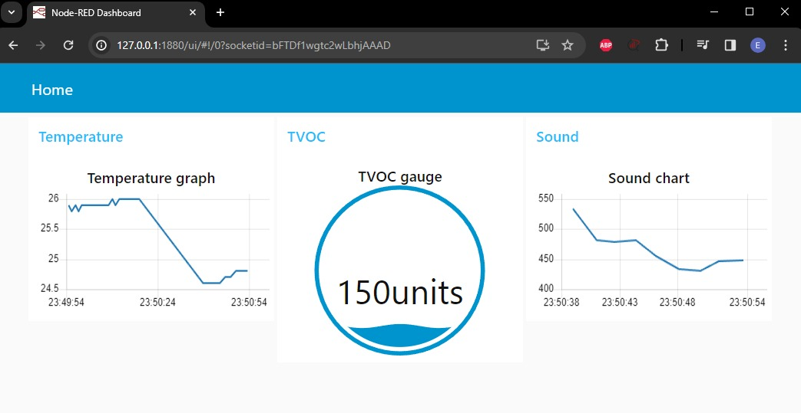


The dashboard was developed using **Node-RED**, a flow-based programming tool for creating web applications through a browser-based editor.

Communication between the **ESP32** and the dashboard is established over **TCP/IP** using the **MQTT** protocol.
The system consists of two MQTT clients—the ESP32 and the dashboard—which exchange messages through a locally hosted **MQTT broker** running on the laptop.


**FIGURE: MQTT architecture**

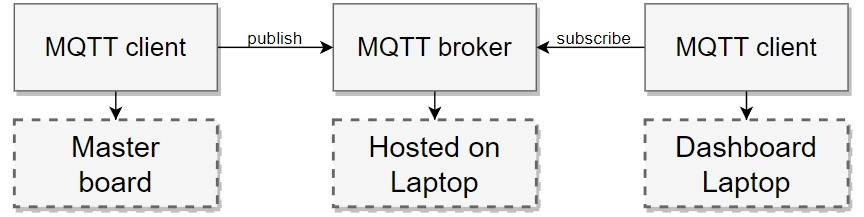


**MQTT** is a lightweight messaging protocol designed for IoT applications.
Clients communicate exclusively with the broker by publishing data to or subscribing to **topics**, without needing direct connections to other clients.
In this project, three topics were implemented to transmit **temperature**, **TVOC**, and **sound** data.

**FIGURE: Node Red webpage flow**

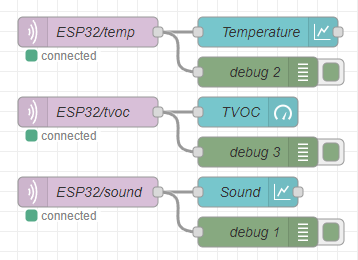


The Node-RED flow code:

``` json
[ { "id": "156fbaa406ad8123", "type": "tab", "label": "Flow 1", "disabled": false, "info": "", "env": [] }, { "id": "203987ec71ee9f87", "type": "mqtt in", "z": "156fbaa406ad8123", "name": "ESP32/temp", "topic": "ESP32/temp", "qos": "2", "datatype": "auto-detect", "broker": "a03b8463c0d7b983", "nl": false, "rap": true, "rh": 0, "inputs": 0, "x": 370, "y": 300, "wires": [ [ "9a7d31c60c80b677", "3804aaebb1665203" ] ] }, { "id": "a187927df009e949", "type": "ui_gauge", "z": "156fbaa406ad8123", "name": "TVOC", "group": "f6d1c6bb403af6e6", "order": 0, "width": 0, "height": 0, "gtype": "wave", "title": "TVOC gauge", "label": "units", "format": "{{value}}", "min": 0, "max": "1023", "colors": [ "#00b500", "#e6e600", "#ca3838" ], "seg1": "", "seg2": "", "diff": false, "className": "", "x": 530, "y": 380, "wires": [] }, { "id": "830a1915f1ec3c49", "type": "mqtt in", "z": "156fbaa406ad8123", "name": "ESP32/tvoc", "topic": "ESP32/tvoc", "qos": "2", "datatype": "auto-detect", "broker": "a03b8463c0d7b983", "nl": false, "rap": true, "rh": 0, "inputs": 0, "x": 370, "y": 380, "wires": [ [ "a187927df009e949", "2759dc64eb94826a" ] ] }, { "id": "fb719ceab83b097f", "type": "mqtt in", "z": "156fbaa406ad8123", "name": "ESP32/sound", "topic": "ESP32/sound", "qos": "2", "datatype": "auto-detect", "broker": "a03b8463c0d7b983", "nl": false, "rap": true, "rh": 0, "inputs": 0, "x": 370, "y": 460, "wires": [ [ "7c6e3bf5c472d3e7", "3bb8702e06e15257" ] ] }, { "id": "9a7d31c60c80b677", "type": "ui_chart", "z": "156fbaa406ad8123", "name": "Temperature", "group": "f456dba3c69cf4bc", "order": 1, "width": 0, "height": 0, "label": "Temperature graph", "chartType": "line", "legend": "false", "xformat": "HH:mm:ss", "interpolate": "linear", "nodata": "", "dot": false, "ymin": "", "ymax": "", "removeOlder": 1, "removeOlderPoints": "", "removeOlderUnit": "3600", "cutout": 0, "useOneColor": false, "useUTC": false, "colors": [ "#1f77b4", "#aec7e8", "#ff7f0e", "#2ca02c", "#98df8a", "#d62728", "#ff9896", "#9467bd", "#c5b0d5" ], "outputs": 1, "useDifferentColor": false, "className": "", "x": 550, "y": 300, "wires": [ [] ] }, { "id": "7c6e3bf5c472d3e7", "type": "ui_chart", "z": "156fbaa406ad8123", "name": "Sound", "group": "fa9c6e33a42140ac", "order": 1, "width": 0, "height": 0, "label": "Sound chart", "chartType": "line", "legend": "false", "xformat": "HH:mm:ss", "interpolate": "linear", "nodata": "", "dot": false, "ymin": "", "ymax": "", "removeOlder": 1, "removeOlderPoints": "", "removeOlderUnit": "3600", "cutout": 0, "useOneColor": false, "useUTC": false, "colors": [ "#1f77b4", "#aec7e8", "#ff7f0e", "#2ca02c", "#98df8a", "#d62728", "#ff9896", "#9467bd", "#c5b0d5" ], "outputs": 1, "useDifferentColor": false, "className": "", "x": 530, "y": 460, "wires": [ [] ] }, { "id": "3bb8702e06e15257", "type": "debug", "z": "156fbaa406ad8123", "name": "debug 1", "active": true, "tosidebar": true, "console": false, "tostatus": false, "complete": "false", "statusVal": "", "statusType": "auto", "x": 540, "y": 500, "wires": [] }, { "id": "3804aaebb1665203", "type": "debug", "z": "156fbaa406ad8123", "name": "debug 2", "active": true, "tosidebar": true, "console": false, "tostatus": false, "complete": "false", "statusVal": "", "statusType": "auto", "x": 540, "y": 340, "wires": [] }, { "id": "2759dc64eb94826a", "type": "debug", "z": "156fbaa406ad8123", "name": "debug 3", "active": true, "tosidebar": true, "console": false, "tostatus": false, "complete": "false", "statusVal": "", "statusType": "auto", "x": 540, "y": 420, "wires": [] }, { "id": "a03b8463c0d7b983", "type": "mqtt-broker", "name": "ESP32", "broker": "localhost", "port": "1883", "clientid": "", "autoConnect": true, "usetls": false, "protocolVersion": "4", "keepalive": "60", "cleansession": true, "autoUnsubscribe": true, "birthTopic": "ESP32", "birthQos": "1", "birthRetain": "false", "birthPayload": "", "birthMsg": {}, "closeTopic": "", "closeQos": "0", "closeRetain": "false", "closePayload": "", "closeMsg": {}, "willTopic": "", "willQos": "0", "willRetain": "false", "willPayload": "", "willMsg": {}, "userProps": "", "sessionExpiry": "" }, { "id": "f6d1c6bb403af6e6", "type": "ui_group", "name": "TVOC", "tab": "8593b1ea584e9609", "order": 2, "disp": true, "width": "6", "collapse": false, "className": "" }, { "id": "f456dba3c69cf4bc", "type": "ui_group", "name": "Temperature", "tab": "8593b1ea584e9609", "order": 1, "disp": true, "width": "6", "collapse": false, "className": "" }, { "id": "fa9c6e33a42140ac", "type": "ui_group", "name": "Sound", "tab": "8593b1ea584e9609", "order": 3, "disp": true, "width": "6", "collapse": false, "className": "" }, { "id": "8593b1ea584e9609", "type": "ui_tab", "name": "Home", "icon": "dashboard", "order": 1, "disabled": false, "hidden": false } ]
```


<!-- ______________________________________________________________________________________________________________________________________________________ CONCLUSION -->
# :checkered_flag: 5. Conclusion

This project successfully developed the infrastructure for a configurable indoor air quality monitoring system.
Its modular architecture enables easy deployment and reconfiguration of devices, while the MQTT-based communication framework supports scalable integration of numerous clients.
As a result, new monitoring devices can be added to the dashboard with minimal effort, providing a flexible and extensible solution for indoor environmental monitoring.


<!-- ______________________________________________________________________________________________________________________________________________________ RESOURCES -->
# :books: 5. Resources

- [ ESP32 datasheet ]( https://documentation.espressif.com/esp32-wroom-32_datasheet_en.pdf )
- [ ATMEGA328P datasheet ]( https://ww1.microchip.com/downloads/en/DeviceDoc/Atmel-7810-Automotive-Microcontrollers-ATmega328P_Datasheet.pdf )
- [ MCP16311 datasheet ]( https://ww1.microchip.com/downloads/en/DeviceDoc/MCP16311-Family-Data-Sheet-DS20005255C.pdf )
- [ ADT7410 datasheet ]( https://www.analog.com/media/en/technical-documentation/data-sheets/adt7410.pdf )
- [ ADT7410 library ]( https://github.com/adafruit/Adafruit_ADT7410 )
- [ DS18B20 datasheet ]( https://www.analog.com/media/en/technical-documentation/data-sheets/ds18b20.pdf )
- [ DS18B20 library ]( https://github.com/milesburton/Arduino-Temperature-Control-Library )
- [ One Wire library ]( https://github.com/PaulStoffregen/OneWire )
- [ Node-RED documentation ]( https://nodered.org/docs/getting-started/ )
- [ Node-RED and MQTT tutorial and libraries ]( https://microcontrollerslab.com/esp32-mqtt-publish-multiple-sensor-readings-node-red/ )
